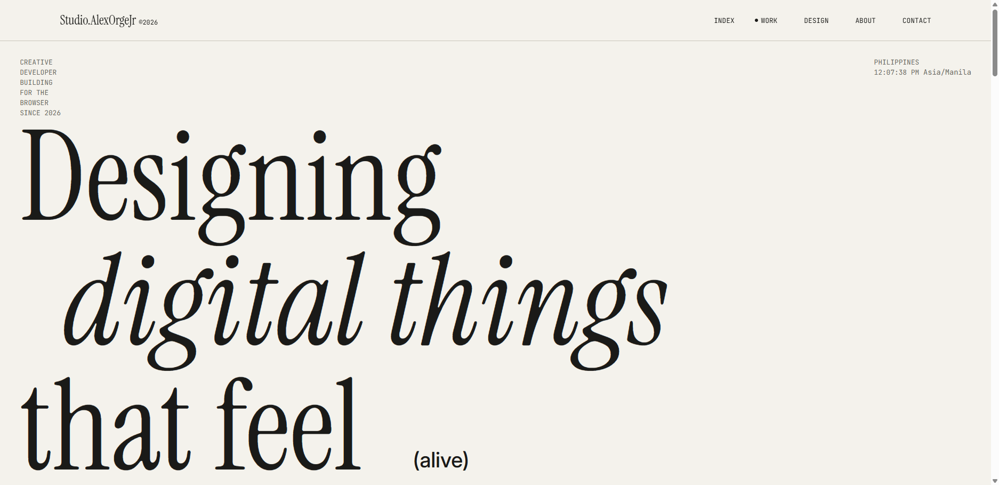

# Web Portfolio

Personal portfolio website about my career and life, built with [Astro](https://astro.build).

🔗 **Live site:** [Studio.AlexOrgeJrt](https://studio.alexorgejr.workers.dev)



[View full-page screenshot](./docs/screenshot-full.png)

## Tech Stack

- Astro
- TypeScript
- Deployed on (Vercel / Netlify / GitHub Pages)

## Run Locally

```bash
git clone https://github.com/AlexOrgeJr/Web-Portfolio.git
cd Web-Portfolio
npm install
npm run dev
```

The dev server starts at `localhost:4321`. Use `npm run build` to create a production build in `./dist/`.

## Contact

[@AlexOrgeJr](https://github.com/AlexOrgeJr) · alexanderorgejr1@gmail.com
